  

  

---

## `~/whoami`

`$ whoami`

**foysal-ahammad**

`$ echo $ROLE`

**Developer • Builder • Automation Enthusiast**

`$ echo $MISSION`

**Build what I imagine.**

I build **Android apps, web apps, Lua scripts, Telegram bots and Telegram Mini Apps**, with a strong interest in automation, AI tools and experimental projects.

---

## `~/system/status`

| Module | Status |
|:--|:--|
| 🤖 Agent 24 | 🟢 Primary Build |
| 📱 App Development | 🟢 Active |
| 🌐 Web App Development | 🟢 Active |
| 🎮 Lua Scripting | 🟡 Coming Soon |
| 🤖 Telegram Bots | 🟢 Active |
| ⚡ Telegram Mini Apps | 🟢 Active |
| 🔁 WiFi Repeater | 🔵 Shipped · v1.0.0 |

---

## `~/skills`

`$ ./load-skills.sh`

`[████████████████████████████████] 100%`

 

 

---

# `~/projects`

## 🤖 Agent 24

**AUTONOMOUS AI ASSISTANT · ANDROID · ACTIVE**

Agent 24 is an autonomous AI coding & technical assistant running directly on Android.

**Capabilities**

- Chat
- Planning
- Tool execution
- Terminal
- Code editor
- Filesystem
- Device control
- Automation

---

## 🔁 WiFi Repeater

**ESP32 FIRMWARE · SHIPPED · v1.0.0**

ESP32-based NAT range extender with a web control panel, JSON status API, mDNS and NAPT.

**Features**

- Web control panel
- JSON status API
- mDNS
- NAPT
- Pre-built firmware
- GitHub Release

---

## 🎮 Game Hacking · Lua

**LUA SCRIPT LAB · WIP**

Experimental Lua scripting projects for game automation and modding.

`STATUS: UNDER DEVELOPMENT`

`RELEASE: COMING SOON`

---

# `~/terminal`

`$ cd ~/projects`

`$ git status`

**On branch main**

Changes not staged for commit:

- modified `ideas/`
- modified `projects/`
- modified `future/`

Untracked files:

- `next-big-thing`

`$ echo "nothing is finished."`

**nothing is finished.**

**everything is building.**

---

# `~/github`

 

 

---

# `~/activity`

`$ tail -n 6 /var/log/foysal.log`

`[INFO] Agent 24 development active`

`[INFO] Android systems online`

`[INFO] Telegram projects online`

`[INFO] Lua laboratory initialized`

`[INFO] New ideas detected`

`[BUILD] ████████████████████ 100%`

---

# `~/philosophy`

**THINK**

↓

**BUILD**

↓

**BREAK**

↓

**FIX**

↓

**SHIP**

↓

**REPEAT**

 

### `I BUILD WHAT I IMAGINE.`

---

# `~/contact`

---

 

  

<b>Foysal Ahammad</b> · terminal-cyberpunk profile · © 2026

